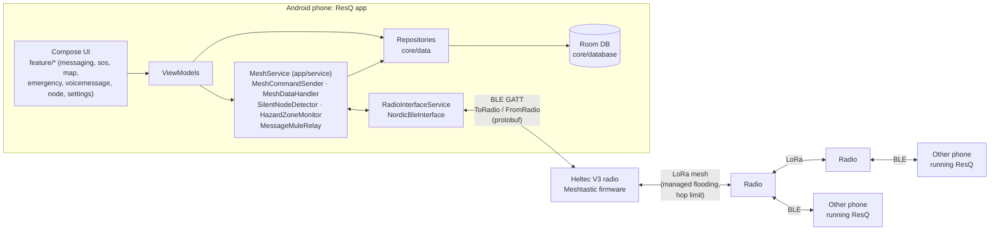

# ResQ: offline emergency coordination over LoRa mesh

ResQ is an Android app for coordinating rescue work when there is no cellular or internet service. Each phone connects over Bluetooth Low Energy to a small LoRa radio running [Meshtastic](https://meshtastic.org) firmware. The radios form a mesh and relay packets to each other over several kilometres, with no towers or servers involved.

ResQ is a **fork of [Meshtastic-Android](https://github.com/meshtastic/Meshtastic-Android)** (GPL-3.0), taken at upstream commit `9266caae9` (2026-01-21). Upstream provides the radio connection, the protocol, messaging, node list, maps and settings. ResQ adds the emergency-response features listed below.

> B.Tech final-year project, Department of CSE, B.S. Abdur Rahman Crescent Institute of Science and Technology, 2026; supervisor Dr. A. Salman Ayaz.

## The problem

During floods, earthquakes and large power cuts, mobile networks are often the first thing to fail. Rescue teams then lose the ability to share where victims are, who is handling what, and whether a team member has stopped responding. Meshtastic already solves basic off-grid text messaging. ResQ builds rescue-specific workflows on top of it.

## What ResQ adds to Meshtastic-Android

| Feature | What it does | Main code |
|---|---|---|
| **SOS** | Confirmation dialog, then a broadcast at ALERT priority with hop limit 7, including the sender's name and GPS position. It then re-broadcasts an updated position every 2 minutes until stopped. It can also be triggered from a notification action. | `feature/sos/`, `app/.../service/SOSReceiver.kt` |
| **Message priority** | Normal / High / Critical Alert selector on every message. When channel utilisation passes 70 % (85 %), Normal (and High) text messages are refused so the airtime stays free for urgent traffic. ⚠ The utilisation is currently set by a **simulation slider**, not read from the radio. | `feature/messaging/Message.kt`, `app/.../service/MeshCommandSender.kt` |
| **Triage map** | Place START-triage pins (RED/YELLOW/GREEN/BLACK, with victim count) shared with every node; rescuers can claim a pin; conflicting pins are merged. | `feature/map/.../triage/`, `core/model/.../triage/` |
| **Rescuer assignment** | Assigns rescuers to victims with the Hungarian algorithm, using distance weighted by triage urgency; assignments can be locked by the incident commander and are broadcast to the team. | `AssignmentEngine.kt`, `HungarianSolver.kt` |
| **Silent-node detection** | Pings each node every 2 minutes. 2 missed pings mark it SILENT, 3 mark it CONFIRMED SILENT. The app then alerts the channel with the node's last position and drops a RED pin on the map, and removes the pin when the node comes back. | `app/.../service/SilentNodeDetector.kt` |
| **Hazard zones** | Draw polygon zones (flood, fire, chemical…), share them over the mesh, and get a local notification on entering or leaving one. Detection works even with the radio disconnected. | `core/model/.../hazard/`, `app/.../service/HazardZoneMonitor.kt` |
| **Voice messages** | Up to 5 s of audio, compressed with Codec2 at 1,200 bit/s and sent as ≤ 216-byte fragments. | `feature/voicemessage/`, `core/audio/`, `app/src/main/cpp/` |
| **Delayed retry ("Message Mule")** | A direct message that fails is kept on the sender's phone and retried every 5 min, and immediately when the recipient is heard, for up to 48 h. | `app/.../service/MessageMuleRelay.kt` |
| **Offline emergency guide** | 12 first-aid topics, 5 disaster topics and 4 survival topics, bundled as JSON. | `feature/emergency/`, `app/src/main/assets/emergency_guide.json` |
| **BLE recovery** | Automatic reconnect after radio link errors (median 17.9 s to usable in testing), with connection and handshake timeouts. | `app/.../repository/radio/` |

## Architecture



- **The phone does not route.** Relaying, hop counting and encryption happen in the radio firmware. The app hands each packet to its own radio with a destination, port, priority and hop limit.
- **BLE is only the phone↔radio link.** Phones never talk to each other directly over Bluetooth.
- **Packet types used by ResQ:**

  | Content | Meshtastic port | Encoding |
  |---|---|---|
  | Chat, SOS, silent-node alert | `TEXT_MESSAGE_APP` (1) | UTF-8 text |
  | Triage pin / claim / assignment, hazard zone | `PRIVATE_APP` (256) | JSON (`kotlinx.serialization`) with a `type` field |
  | Heartbeat ping, silence report | `PRIVATE_APP` (256) | `HEARTBEAT_PING|…`, `SILENCE_REPORT|…` text |
  | Voice fragment | `AUDIO_APP` (9) | 14-byte binary header + Codec2 frames |

## Building

Requirements (from the Gradle configuration):

| | Version | Source |
|---|---|---|
| JDK | 21 | `jvmToolchain(21)` in `build-logic/.../KotlinAndroid.kt`; `gradle/gradle-daemon-jvm.properties` |
| Android Gradle Plugin / Kotlin | 9.0.0 / 2.3.0 | `gradle/libs.versions.toml` |
| Android SDK | compile/target 36, **min 26 (Android 8.0)** | `config.properties` |
| CMake | 3.22.1 (for the Codec2 native library) | `app/build.gradle.kts` |
| Android NDK | installed via SDK Manager (ABIs: armeabi-v7a, arm64-v8a, x86, x86_64) | `app/build.gradle.kts` |

```bash
git clone <this repo>
cd <repo>
git submodule update --init          # Meshtastic protobufs -> core/proto/src/main/proto
# optional: real keys in secrets.properties (see secrets.defaults.properties for names);
#           the placeholder defaults are enough for a debug build
./gradlew :app:assembleGoogleDebug    # APK -> app/build/outputs/apk/google/debug/
./gradlew :app:installGoogleDebug     # install on a connected phone
./gradlew test                        # unit tests
```

The only product flavour is `google` (the F-Droid flavour was removed in `62a5326d2`). `assembleGoogle*` appears in `./gradlew :app:tasks --group build`; `installGoogleDebug` is the standard AGP install task for that variant. A full build was **not** run while writing this README; build it once before you publish.

## Running

1. Flash a Meshtastic-compatible LoRa board (tested with **Heltec V3**) with Meshtastic firmware, using the region setting legal in your country.
2. Install ResQ on the phone, grant Bluetooth and location permissions, and pair with the radio from the Connections screen.
3. Repeat for each team member. Radios on the same channel and region form the mesh automatically.
4. For anything sensitive, set a **custom channel key**. The default channel uses Meshtastic's publicly known key, so anyone with a Meshtastic radio can read it.

## Testing done so far

The only tests so far are bench tests: two Motorola phones (edge 50 pro, edge 60 pro) and three Heltec V3 radios, about 4 m apart (February and September 2026). Measured: one silent-node detection cycle (silent after 316 s, confirmed after 436 s), ACK round-trips of 0.6–13 s, phone-to-phone delivery of triage packets in 1.2–2.7 s, BLE recovery in about 18 s, and no crashes. Range, multi-hop delivery ratio, SOS latency and battery life **have not been measured yet**.

## Limitations

- Congestion-based priority uses a **simulated** channel-utilisation value.
- Voice messages have no fragment retransmission, so one lost fragment loses the message.
- Triage and hazard packets are JSON, which uses more of the ~230-byte LoRa payload than protobuf would.
- Hazard-zone geometry treats lat/lon as a plane and has no hysteresis at the boundary.
- SOS location is sent as free text on the default channel.
- Two silent-node detectors exist (the service detector and a simpler one on the map) and should be merged.
- No field (range or multi-hop) evaluation yet.

## Credits and licences

- **Meshtastic-Android**, © Meshtastic LLC and contributors, GPL-3.0. ResQ is a derivative work and is distributed under **GPL-3.0**; see `LICENSE`.
- **Meshtastic protobufs** (git submodule), GPL-3.0. **Meshtastic firmware** runs on the radios.
- **Codec2**, © David Rowe, LGPL-2.1, vendored in `app/src/main/cpp/codec2/`.
- **osmdroid** 6.1.20 (maps), **Nordic Kotlin BLE client** (`no.nordicsemi.kotlin.ble:client-android`), AndroidX (Room, Paging, Compose), Hilt and kotlinx.serialization are under their respective licences.
- First-aid content is adapted from IFRC, WHO, St John Ambulance, American Red Cross, FEMA and the UK Resuscitation Council guidance (as listed in `emergency_guide.json`). It is **not a substitute for professional training.**
